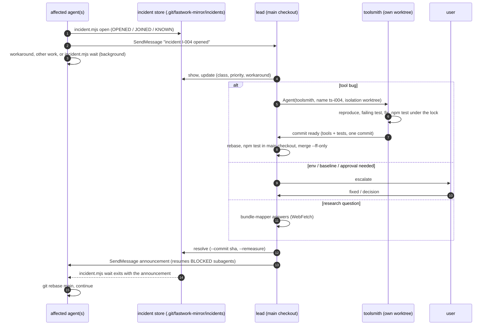

# Incidents: unexpected problems during parallel work

What every agent does when something breaks that is **not** its own topic's code: a tool crashes or
prints wrong numbers, Chrome won't start, a port or lock is stuck, the iPhone proxy is gone, Serena
is missing, the baseline looks wrong, or a web-platform question blocks a decision. Goal: one report
per problem, one fixer, everyone else keeps working, and everyone affected hears when it is fixed.
Roles: [`AGENT_ROLES.md`](AGENT_ROLES.md). The lead's side of this loop is also listed step by step
in [`LEAD.md`](LEAD.md) "While owners work".

## Where incidents live

`node tools/incident.mjs` keeps one JSON file per incident in the shared git dir,
`.git/fastwork-mirror/incidents/I-001.json`, next to the locks. Why not a committed log file: a
worktree sees a committed file only after the lead lands it and the
worktree rebases, so a second agent would hit the same bug and report it again. The shared dir is
visible to every worktree at once, writes are serialized by the lock library's guard, and the store
survives sessions (it lives in this clone's `.git`, never in a commit or on a remote). It may hold
local paths and command output: it stays on this machine (`CLAUDE.md` "Hard rules" 12). The durable
public trace of a fix is its commit: tool-fix subjects end with `(incident I-00x)`.

Lifecycle: `open` → `triaged` → `fixing` → `resolved` (fixed / workaround / answered / not-a-bug /
duplicate) or `parked`. `list` shows the active ones, `list --all` the history.

## 1. Report (any agent)

Report as soon as you are sure it is not your own mistake (wrong path, wrong worktree, your overlay
has a syntax error). First try the obvious: `node tools/fix.mjs doctor`, `node tools/lock.mjs
status`, `git rebase main` (the fix may already be there). Then:

```sh
node tools/incident.mjs open --by <your agent name> \
  --title "<what failed, one line>" \
  --error "<the first error line, verbatim>" \
  --class tool|env|baseline|research|fix|unknown \
  --cmd "<the exact command>" \
  --output-file <log file> \
  --repro "<smallest steps that show it; how often: always / 1 in 5>" \
  --env "<anything unusual: other agents measuring, iPhone state, first run in a fresh worktree>" \
  --suspect "<file:line or area, if you have a guess>" \
  --blocking yes|no \
  --workaround "<what lets you continue, if you found one>"
```

| field | why the lead needs it |
|---|---|
| `--error` | the dedup key: the first line with paths, URLs, hex ids and numbers masked. Paste it verbatim. For a failure without an error line (wrong numbers, hang), give `--sig <short-key>` so others can join it, e.g. `--sig ab-hangs-after-run-3` |
| `--cmd`, `--output-file` | to reproduce without asking you (or `--output "<last lines>"`; the last 8 KB are kept) |
| `--repro` | smallest steps and frequency; "always" vs "1 in 5" decides between a bug and a race |
| `--env` | checkout, branch, HEAD, node, OS and load are recorded automatically; add the rest |
| `--blocking` | `yes` = you cannot continue your topic without it (sets priority) |
| `--workaround` | shared with everyone who hits it next |

The first word of the answer tells you what to do:

| answer | meaning | you do |
|---|---|---|
| `OPENED I-004` | new incident | message the lead (template below), then section 2 |
| `JOINED I-003 [fixing, ts-i003 is on it]` | someone reported it already; you are now listed as affected | don't fix it in parallel; use its workaround; section 2 |
| `KNOWN I-002: fixed in abc1234 on main` | already fixed, your branch lacks it | `git rebase main`, retry |
| `OPENED I-005 (recurrence of I-002 …)` | the fix is in your HEAD and it still fails | message the lead: repeated failure |

Message to the lead (teammates and named subagents, `SendMessage` to `main` / the lead):

```
incident I-004 opened (tool, blocking): fix.mjs ab crashes after run 3 in summarize(). Workaround: none.
I'm continuing with the README meanwhile / I'm waiting (incident.mjs wait running).
```

**Fixing it yourself** (`CLAUDE.md` "Hard rules" 6 still allows it) only when all hold: you are
blocked, nobody is assigned (`show` has no assignee), the fix is small and local, and it is not
measurement code (`verify.mjs`, `lib/cdp.mjs`, `fix.mjs ab`, served bytes in `serve.mjs` /
`vendor-shim.js`) and not the enforcement layer. Claim it first so nobody fixes it twice:
`node tools/incident.mjs update I-004 --by <you> --status fixing --assignee <you> --note "self-fix"`.
Then fix it test-first like the toolsmith does ([`.claude/agents/toolsmith.md`](../.claude/agents/toolsmith.md)):
covering test, `npm test` green, one separate `tools: … (incident I-004)` commit, and message the
lead the commit. Everything else goes to a toolsmith.

## 2. While it is open (the affected agent)

In this order:
1. **Workaround** from the incident (`show I-004`), if any. Note it in your README if it touches
   what you measure.
2. **Other work of your topic** that doesn't need the broken piece: evidence, design, the README,
   the next measurement plan.
3. **Wait in the background:** `node tools/incident.mjs wait I-004 --timeout 3600` with Bash
   `run_in_background`. It exits when the incident is resolved or parked and prints the
   announcement, so you get the news even if no message reaches you.
4. **Worktree subagent with nothing left to do:** end your run with a `BLOCKED` report (template
   below). The lead resumes you with `SendMessage` after the fix; your conversation is kept.

Never: patch around a shared tool silently in your branch, bypass an enforcement layer, keep the
`iphone` lease or a queue place while blocked (`lock.mjs release` / `dequeue`), or run CPU-heavy
debugging (loops of `npm test`, extra Chromes) while someone holds `chrome-measure`.

```
BLOCKED on I-004 (fix.mjs ab crashes after run 3).
Done: evidence, overlay patch (node --check ok), README draft. Not done: A/B, results.json.
Resume with: rebase main, then node tools/fix.mjs ab <topic> --runs 5.
```

## 3. Triage (the lead)

The lead is the coordinator: it is the only agent that can spawn teammates, land on `main` and talk
to the user, and it receives every teammate's permission prompts ([`AGENT_ROLES.md`](AGENT_ROLES.md)
"Why the lead coordinates incidents"). Triage stays short: class, priority, owner, workaround.
Diagnosis belongs to whoever fixes it.

```sh
node tools/incident.mjs list                     # after every report, and at each check-in
node tools/incident.mjs show I-004
node tools/incident.mjs update I-004 --by lead --class tool --priority P0 --status triaged --workaround "..."
```

| class | examples | who fixes | default |
|---|---|---|---|
| `tool` | a crash, a hang, wrong or missing numbers in `results.json`, a flaky test that blocks the pre-commit gate | a `toolsmith` (section 4), or the reporter's self-fix | fix now if P0/P1 |
| `env` | Chrome won't launch or its profile is locked, port taken, stale lock whose holder is gone, inconsistent lock state (queue, last grant, guard), iPhone locked / Safari in the background / proxy down, Serena missing, disk full | the lead (servers it started; locks: `lock.mjs doctor`, then `lock.mjs repair <res>` (dry run) and `repair <res> --by lead --reason "…" --apply`, audited in `locks/audit.log`; `--force-holder` only after checking the holder's pid is gone or hung; never hand-edit the lock JSON, I-012) or the user (physical device, `/mcp`, installs) | workaround or escalate |
| `baseline` | `site/` or `site-pretty/` incomplete or stale, manifest mismatch | only the user (`mirror.mjs` / `prettify.mjs` rewrite the shared baseline, Hard rule 4) | park until no one measures; afterwards every A/B result is stale: all open topics re-measure |
| `research` | "does iOS Safari fire `resize` on toolbar collapse?", "is `animation-timeline` in WebKit 26?" | a `bundle-mapper` spawned by the lead (no `name`), WebFetch + summary | `resolve --resolution answered --note "<answer + source>"` |
| `fix` | two topics' patches disagree; a topic's own code bug reported as a tool bug | the topic owners ([`TOPICS.md`](TOPICS.md) conflicts) | `resolve --resolution not-a-bug --note "<routed to …>"` |
| `unknown` | nobody can tell yet | a toolsmith told to diagnose first | reclassify after |

| priority | when | response |
|---|---|---|
| P0 | blocks at least one agent with no workaround, or may have produced **wrong numbers** | dispatch now |
| P1 | blocks but has a workaround, or makes the `npm test` gate flaky | dispatch when a toolsmith slot is free |
| P2 | an annoyance | batch at the end of the wave |
| P3 | not worth fixing now | `--status parked` with the reason |

Dedup: identical failures join automatically. A duplicate the store missed (different error text,
same cause): `resolve <dup> --by lead --resolution duplicate --note "see I-003"` and
`update I-003 --by lead --affected <its reporters>`.

## 4. Dispatch a toolsmith (the lead)

```sh
node tools/incident.mjs update I-004 --by lead --status fixing --assignee ts-i004
```

`Agent(subagent_type: "toolsmith", name: "ts-i004", isolation: "worktree", prompt: "Incident I-004
(<title>). Affected: <names>. Priority P0. Measurement code likely: yes/no. Scope: <one line>.")`

`isolation` on the call keeps it a subagent even with agent teams on: it gets its own worktree from
`main`, its definition's effort, and runs in the background. One toolsmith per incident; at most
two at a time, and only if they touch different files. Then `node tools/incident.mjs announce I-004`
and send that text (status FIXING, the workaround) to every affected agent.

## 5. Land and announce (the lead)

When the toolsmith reports its commit (or a self-fixer does):

```sh
git -C <toolsmith worktree> rebase main
git -C <toolsmith worktree> diff --stat main...HEAD      # tools/ and tests/ only, one commit
git status --short                                        # main checkout must be clean
git switch --detach <toolsmith branch>                    # test the exact commit where site/ exists
node tools/lock.mjs run chrome-measure --owner land-i004 --short --max-seconds 120 -- npm test
git switch main && git merge --ff-only <toolsmith branch>
node tools/incident.mjs resolve I-004 --by lead --commit <sha> [--remeasure]
```

Run `npm test` in the **main checkout**, not only in the worktree: the main checkout has `site/`
and worktrees don't, and a test has passed in a worktree while hanging in the main checkout
(`7abd290`). Holding `chrome-measure` keeps the test run from disturbing someone's A/B (Hard rule 7).
The user's server on port 5173 keeps running through the switch: its code is already loaded.
A change to measurement code gets a `fix-reviewer` pass (tool mode) before landing and
`--remeasure` on `resolve`. `resolve` refuses a commit that is not on `main` yet.

**Announcement.** `resolve` prints it (again any time with `announce I-004`):

```
[incident I-004] RESOLVED (fixed): fix.mjs ab crashes after run 3
Fix: 1a2b3c4d5e on main: tools: summarize() handles a run without morph phase (incident I-004)
Action: in your worktree run `git rebase main` (check: `git merge-base --is-ancestor 1a2b3c4d5e HEAD`), then continue; re-run: node tools/fix.mjs ab hero --runs 5.
Re-measure: the fix changed measurement code; A/B results measured before 1a2b3c4d5e are not comparable, run fix.mjs ab again after rebasing.
Affected: fix-hero-exit-scroll-timeline, fix-nav-hit-test
```

Deliver it:
- **Teammates** (agent team): `SendMessage` to each affected teammate; for a `tool` fix, to every
  active teammate (all of them run the tools, and a rebase is cheap). A teammate between steps
  rebases at once; one inside an A/B finishes it first (and redoes it if `Re-measure` says so).
- **Named worktree subagents:** `SendMessage` by name. A running one gets it as a course correction;
  one that ended with `BLOCKED on I-004` is **resumed** by the same message, with its history.
  Don't message subagents that finished their work: a message resumes them too.
- **Helpers** (a fix owner's mappers) are not told; their owner is.
- **Pull channel:** agents running `incident.mjs wait` wake up by themselves; anyone who missed
  everything gets `KNOWN … git rebase main` when they report the same failure.

Check who is still on old tools:

```sh
git worktree list --porcelain | awk '/^worktree /{print $2}' | while read -r wt; do
  git -C "$wt" merge-base --is-ancestor <sha> HEAD && echo "ok    $wt" || echo "STALE $wt"; done
```

## 6. Escalate to the user (the lead)

- Anything physical or outside the repo: unlock the iPhone, bring Safari forward, restart
  `ios_webkit_debug_proxy`, a finger test, update or reinstall Chrome, reconnect Serena (`/mcp`),
  free disk space.
- Anything that needs approval: edits to the enforcement layer (`.githooks/`, `.claude/hooks/`,
  `.claude/settings.json`), re-running `mirror.mjs` / `prettify.mjs`, killing a process the team
  didn't start, anything near port 5173.
- A **recurrence** (the same failure after its fix landed), or two toolsmith attempts that didn't fix it.
- A P0 that keeps half the team blocked for more than ~30 minutes.
- Anything that might touch the study's ground rules: Fastwork content leaving the machine, the
  user's personal data, the live site.

## The loop


