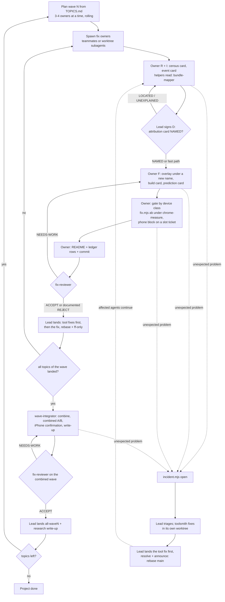

# Lead playbook

For the main Claude Code session in the main checkout: it runs the whole loop (plan a wave, spawn
fix owners, keep them unblocked, review, land, integrate, write up, next wave). Roles, spawn
mechanics and the model/effort guide are in [`AGENT_ROLES.md`](AGENT_ROLES.md); unexpected problems
in [`INCIDENTS.md`](INCIDENTS.md); rules in `CLAUDE.md` "Hard rules". Merges into `main` use
**rebase + `git merge --ff-only` only**: no merge commits, no `--no-ff`, no squash; if ff-only fails,
rebase again.

## Standing authority

The user made the lead the orchestrator until the job is done (2026-10-01): triage incidents, spawn
toolsmiths, fix owners, integrators and reviewers, start new topic owners for new findings, land work
(rebase + ff-only) and announce fixes **without asking the user for each step**. The project goal is
"ultra smooth" scrolling: on the calibrated setting, frames >50 ms → 0 and >34 ms → ~0; on the real
iPhone a steady 60 fps under a finger scroll with no frame >50 ms.

Still ask the user for what only they can do or approve: iPhone finger tests, edits to the
enforcement layer (`.claude/settings.json`, `.claude/hooks/`, `.githooks/`) when Claude Code's
safety check blocks them, and anything that leaves this machine.

Interventions on shared state go through a tool, never raw writes: fixing lock, queue or incident state
by hand (`node -e writeFileSync(...)` on `.git/fastwork-mirror/`) is unaudited, can race a live acquire,
and Claude Code's safety check rightly blocks it (I-012). Use `lock.mjs doctor` / `lock.mjs repair … --apply`
(dry-run by default, audited in `locks/audit.log`) and `incident.mjs`. If no subcommand covers the case,
open an incident and have a toolsmith add one rather than editing the file.

## The loop



## Definitions of done

- **Topic:** `fixes/README.md` "Definition of done" holds; `fix-reviewer` said ACCEPT (or the README
  says `Status: rejected` with the evidence); landed on `main`; its tool fixes landed before it;
  no active incident assigned to its owner; its locks released; its worktree and branch removed;
  **its automated benchmark (mechanism + gain check, `fixes/README.md` item 8) is landed and passes on
  the current combined overlay** (required by the user; topics finished before the runner exists get a
  `bench-author` as soon as it lands).
- **Wave:** every topic of the wave is done (landed or rejected-with-evidence); every incident
  opened during the wave is resolved or parked with a reason (`incident.mjs list`, which shows only
  active ones, is empty); `fixes/all-wave<N>/` has the combined patch, a combined A/B with `--runs 5` or more, and
  a README that `fix-reviewer` accepted; every topic's benchmark passes on the combined overlay; the iPhone confirmation is done (scripted scroll baseline vs
  combined, finger test for touch-only topics) or its absence is stated; the write-up
  `research/<nn>-wave<N>-results/README.md` is landed.
- **Project:** all 12 topics of [`TOPICS.md`](TOPICS.md) are landed or rejected with evidence; the
  last combined overlay (all waves) is measured in Chrome and on the iPhone; a final research
  write-up summarizes what helped, what didn't and why; `incident.mjs list` is empty; no lock
  holders, no leftover worktrees or branches besides `main`; history is linear.

## Stages and gates (protocol v2, lead decision 2026-10-01)

Every topic goes through six stages, each closed by a gate
([`research/architecture/measurement-protocol-v2.md`](../research/architecture/measurement-protocol-v2.md) §2;
the lesson behind each rule is its §1 table). A topic skips nothing; a stage can be short. Card templates:
[`_template/CARDS.md`](_template/CARDS.md); the owner's steps: [`AGENT_PROMPT.md`](AGENT_PROMPT.md).

| stage | question | closes with (gate) | signs off |
|---|---|---|---|
| R research | where and how often is it slow? | census card: ≥3 phone runs of one driver + Chrome at 932 and at phone geometry; clusters by crossing; a cluster in <2/3 runs goes on the "rare" list (needs F or G runs before any work) | owner |
| I investigate | what changes in that frame? | event card: crossing table ±1 viewport, uncapped per-step probe (Chrome) and phone logger, hypotheses as element + selector + property, each checked by computed style in Chrome **and** WebKit | owner; mgmt-ops checks it is complete |
| D distinguish | which mechanism and code, on which device? | **attribution card NAMED**: pipeline stage, code, positive + negative ablations with a mechanism check per arm, the axis + one decoupling run (A2), device class; phone-only adds a phone Timeline segment card before F (A1) | **lead** |
| F fix | does the build do only what we intended? | build card + prediction card + ledger row; slot ticket for phone time | owner; mgmt-ops validates the ticket |
| V review | a win on the target device, no regression elsewhere? | review report (`fix-reviewer`, section 4) | fix-reviewer |
| L land | | section 5 | lead |

**What the lead signs.**
- **D, for every topic.** The owner sends the attribution card; reply in one message: `D: NAMED, class
  <Chrome-measurable | phone-only | render-bound | touch-only>, gate <Chrome A/B | phone ABBA | Instruments
  hitches | G/F>` or `D: LOCATED|UNEXPLAINED, <what is missing>`. NAMED needs the positive ablation, ≥1 negative
  sibling ablation and a mechanism check on every arm, all in one block against one control, plus the **axis** the
  frame is locked to (y / crossing, time since a named event, or m) and **one decoupling run** that moves that axis
  apart from the others (hold at another y, change a hold or transition length, shift a threshold); without it, at
  most LOCATED (A2: scripted drivers make y, time and m collinear). A **phone-only** class also needs a **phone
  Timeline segment card** before F (Script / Style / Layout / Paint+Composite / Other, gap − frame, ≥3 captures,
  which segment the fix removes; A1): a Chrome counter at 0 is not phone parity (F-054). A position-moving
  ablation (staging work earlier) proves where the trigger is, never the cost. LOCATED may spend one more phone
  block on ablations; it builds no fix. A render-bound fix stays LOCATED until the Instruments route (T10) is
  verified on this device.
- **Fast path**, when the mechanism is exact and countable in Chrome (a removed listener, a deleted redundant
  write: counts → 0 by construction): a one-line card ("counts X→0, by code") and straight to F. Only the lead
  says a topic qualifies.
- **Also the lead's:** a third phone block for one question (the sequential rule stops at two, protocol §5.3),
  and F (finger) runs, scheduled in batches, never per topic.
- **Prediction misses.** A model with two misses in [`PREDICTIONS.md`](PREDICTIONS.md) (measured outside its
  interval) is reviewed by its author's team before it drives another build; the lead holds that build's ticket.

**Slot tickets (phone access).** Only ticketed builds go on the phone. A ticket names: build + served hashes; the
ONE named control on the same base and its hashes; the driver (S/W/M/G/F); the one question; the prediction id;
the "if X then Y" decision for each outcome; the probe set; the served ports, each with one uncounted warm-up load
(every arm, control included, not one per block: browser caches are per origin, arch-unknowns U5); expected
minutes. mgmt-ops validates it, the lead
ranks the queue (by [`DIRECTION.md`](DIRECTION.md)). **Reorders only at block boundaries**; a running block is
never interrupted. A rejected ticket gets its reason in one message. Block rules (warm-up, sentinel, ≤9 counted
runs, ABBA order, max 2 blocks): `CLAUDE.md` "Shared devices" and protocol §5, plus (amendments A3-A6): warm-up
per arm's port, not only the control's (A3); battery temperature and charging state per run (A4); phone verdicts
in both threshold forms, dt > 50 / k≥7 and dt > 34 / k≥5, frames within 4 ms of a threshold flagged, a verdict
that differs between the forms is threshold-sensitive (A5); M runs report the time-since-tween-start profile and
the |Δm|-weighted dt (A6).

**Canary drift (L8, protocol §6.3).** The canary page drifted from ~92 fps (04:25Z, 93b4af2 tools) to 78 and
75.9 fps (08:31Z, 10:08Z). The Mac's display state explains the floors: plain baseline 63.5-78.3 fps display-on vs
92.2-93.8 DarkWake over 27 holds, no overlap (ddc3450). Rules: **Chrome numbers compare only within one hold** (one
`fix.mjs ab`, or one `lock.mjs run` that measures both sides), never across holds or against older results; each
hold records display / wake / power and keeps it constant (`caffeinate -d -u`, or recorded "off"; T8+); a canary
is checked against display state before any tools bisect; results from different display states never compare
(A7); flag any canary outside the 76-78 fps band for the display-on state and don't use that hold's numbers for a
verdict. Tools differ → bisect 93b4af2..HEAD over the measurement code; host differs → document the band. Lifting
the within-one-hold rule is the lead's call after C1.

## 1. Before a wave

- The session must have started after `.claude/agents/` existed (restart otherwise, then check that
  the Agent tool lists `fix-owner`, `toolsmith`, `wave-integrator`, `bundle-mapper`, `fix-reviewer`).
  Worktrees contain only committed files, so commit tooling and docs first.
- `node tools/fix.mjs doctor`, `node tools/lock.mjs status` (no stale holders),
  `node tools/incident.mjs list` (nothing active from a previous session, or deal with it first).
- Noise floor once per session: `node tools/fix.mjs ab --aa --runs 5`; put its table (or the path
  of `out/ab/_aa/<stamp>/results-aa.json`) into every spawn prompt so owners don't each spend lock
  time on it.
- **Staffing.** Pick the wave from [`TOPICS.md`](TOPICS.md): one owner per topic or conflict cluster,
  **3-4 owners at a time** (the agent-teams docs suggest 3-5; the lock makes more pointless). A
  5-run A/B holds `chrome-measure` for about 5-6 minutes; a topic needs 2-3 of them (main run,
  desktop or a re-run after review), so 4 owners already queue about an hour of lock time, plus about
  75 s per `npm test` a toolsmith or a landing runs under the lock. Run a longer wave rolling: when
  an owner finishes, the next topic starts (wave 1 has 7 owners: start 3+6, 4, 5 and 1; then 8, 9, 11).
  Budget one toolsmith slot on top (two at most, on different files) and the integrator after the wave.
- Teammates inherit your effort: `/effort high` before spawning teammates.

## 2. Spawn

Fill in the block from [`AGENT_PROMPT.md`](AGENT_PROMPT.md) (topic, scope, related owners with the
names you are giving them, A/A numbers, and `--on <combined>` for wave 2).

| | agent-team teammate | worktree subagent |
|---|---|---|
| call | `Agent(subagent_type: "fix-owner", name: "fix-<topic>", prompt: …)` | same plus `isolation: "worktree"` |
| use for | topics that must talk: clusters B, C, D, E | independent topics: 1, 9, 11; every toolsmith and integrator |
| worktree | none at start (runs in the main checkout); step 0 of the prompt enters `.claude/worktrees/fix-<topic>` | created from `HEAD` by Claude Code, branch `worktree-<name>` |
| model / effort | definition `model` (opus) unless the prompt names one; effort = **yours** | definition: opus / high |
| its helpers | foreground subagents (it waits) | background subagents, layer 2 of 3 |
| messages | teammates and you by name; permission prompts come to you | `SendMessage` by name; a finished one is resumed by a message; its result arrives as a notification |

- **Toolsmith** (per incident): `Agent(subagent_type: "toolsmith", name: "ts-i<nnn>", isolation:
  "worktree", prompt: …)`, see [`INCIDENTS.md`](INCIDENTS.md) 4.
- **Integrator** (per wave, after it landed): `Agent(subagent_type: "wave-integrator", name:
  "wave<N>", isolation: "worktree", prompt: "wave N, topics in order: …, A/A: …, previous combined:
  all-wave<N-1> | none, touch-only topics: …, research number: <nn>")`.
- Per-call `model: "fable"` is available for L-size topics (cluster A, `morph-scrolljack-passive`,
  `hero-exit-scroll-timeline`); it may bill usage credits.
- Spawn reviewers and mappers **without a `name`**: a named call from your session becomes a
  teammate, which drops the definition's `effort`.

## 3. While owners work

- **Incidents** (tool bugs, environment failures, baseline problems, research questions): follow
  [`INCIDENTS.md`](INCIDENTS.md) sections 3-6. In short: `incident.mjs list` / `show` after each
  report → class, priority, workaround (`update`) → dispatch a toolsmith (tool) or handle / escalate
  (env, baseline) or a `bundle-mapper` (research) → land the fix first (section 5 here) → `resolve`
  → send the printed announcement to every affected agent (teammates and named subagents by
  `SendMessage`; a message resumes a subagent that ended `BLOCKED`).
- **Fold findings** (incident I-013): `node tools/finding.mjs list --open` at each check-in; forward a
  coupling or pitfall to the owners it names if they haven't acked it. When a few have piled up:
  `node tools/finding.mjs digest` → paste and edit the rows into `fixes/FINDINGS.md`, commit on `main`,
  then `finding.mjs resolve <id> --by lead --folded T<n>|P<n>|lesson|duplicate:F-<n>|rejected --note …`
  for each. The tool never edits `FINDINGS.md`; only the lead resolves.
- **Permission prompts** from teammates and background subagents surface here. Deny any write to
  `site/`, `site-pretty/`, `.githooks/`, `.claude/hooks/`, `.claude/settings.json`, `.serena/`, any
  `git push`/`git add -f`, any chrome-devtools MCP call, and any `git merge` by an owner.
- **iPhone finger tests** (only you can talk to the user): an owner holding the `iphone` lease
  messages "need a finger scroll on <URL>…" → tell the user the URL and what to do (top to bottom,
  then push past the end) and ask them to say when ready → message the owner "user ready, start
  `iphone.mjs record` now" → relay the user's remarks afterwards. One test at a time; the lease queue
  decides the order. You never navigate the phone without holding the lease yourself.
- **Cross-topic disputes:** decide with the conflict table in `TOPICS.md`; one owner changes the
  shared code, the other adapts.
- **Check in** every ~20-30 minutes: `lock.mjs status` (is the queue moving?), `incident.mjs list`,
  `finding.mjs list --open`, idle teammates. An owner stuck on the same step twice gets a question, not a replacement.
- **Host load budget (I-016).** The host has 8 cores. Check `uptime` at every check-in. Above ~8, find
  the cause (`ps` by process kind) before starting anything. Never grant an exception that runs heavy
  work (`npm test`, Chrome, builds) outside `chrome-measure`: route it through the short lane. An
  experiment that is heavy by design (several Chromes at once) gets a quiet window with no tests, and a
  stop rule ("stop at load > N"). Each `npm test` runs ~7 files in parallel, so two suites at once already
  exceed 8 cores. From the postmortem (`research/architecture/postmortem-2026-09-30-overload.md`):
  - any exception that bypasses a lock is written into its incident with a load budget and an expiry
    (<= 30 min), never granted by message alone;
  - heavy-by-design experiments run only in an announced quiet window (2 min quiet host before start,
    self-abort rule, leases <= 15 min per condition);
  - at most ~6 agents doing CPU work while anyone measures; the rest wait or do read-only work;
  - before a clean-numbers window (A/A floor, combined wave A/B), ask the user to close heavy desktop
    apps; macOS load average counts memory stalls, so also check CPU idle (`top -l 1`) and memory pressure;
  - results measured above the gate are tagged, not deleted; the wave's combined A/B must be clean.
- Wait for owners; don't do their work in the lead session.

## 4. Review

When an owner reports done: `Agent(subagent_type: "fix-reviewer", prompt: "topic <t>, worktree
<abs path>, branch <b>, A/A: <numbers>")`. NEEDS-WORK → send the blocking items to the owner, review
again after. A well-documented null or rejected result (README `Status: rejected`) is still worth
landing. For a tool fix that changes measurement code: `prompt: "tool fix, incident I-<nnn>,
worktree <abs path>, branch <b>"`.

Reviewer checklist addition (lead decision 2026-10-01, F-030): every topic that adds observers (IO, RO, MO), listeners or
attribute/style writes gets an **idle-counts probe at y=0** (and at one parked mid-page position) before landing: callbacks/s
and writes/s at rest, base vs patched, in the short lane. review-10c missed /10c's will-change window flipping
`data-fw-wc` on the countdown faces ~1,500 times/s at idle in the hero; an A/B over the scroll phase cannot see it.

Protocol v2 additions (§7; `fix-reviewer.md` "Protocol v2 checks"): the idle probe above becomes the **idle triple**
(y=0, parked mid-page after a scroll, at the pin) for every topic, and the reviewer also checks: attribution card
NAMED with a mechanism check per ablation and no capped logger as evidence; device class matches the gate used;
**position-bin census diff on both devices** (no 250 px bin worse by ≥1 tick median or +1 frame k≥5 per run, not
only the targeted bin; L5: hero v2 fixed y≈50 and grew y≈700 by ~10 ms); a prediction row with measured vs
predicted and a passed closure check; claims scoped to drivers, touch-only fixes with G or F; scenarios not run
listed; phone geometry for attribution and served hashes = the ticket's; heat notes, sentinel passed, within-block
vs the exact base; backdrop look check, a11y diff, memory/layers note. Amendments: a fix that changes a transition
or animation end value (to or from `opacity:1`, `filter:none`, `transform:none`), a layer's presence, a composited
layer's size, an easing to `linear()`/`steps()`, or a window/document wheel/touch listener needs a phone segment card,
not a Chrome counter (X1, F-054); the claim's driver covers the class (speed, toolbar, slow drag, scroll-up, start
after load, touch; X8); phone absolute counts and segment cards made before the P0 logger A/A carry the
logger-layout caveat, while A/B deltas with the same logger stand (A9). A missing item is NEEDS-WORK, not a note.

## 5. Land (rebase + fast-forward only)

`git worktree list` shows each worktree and branch. Keep the main checkout clean (`git status
--short` empty) before switching anything in it.

**Tool fixes first**, on their own, so every agent gets them. A toolsmith branch holds only tool
commits; test the exact commit **in the main checkout** (it has the snapshot checked out, sparse
worktrees don't: a test once passed in a worktree and hung in the main checkout, `7abd290`) and under the lock:

```sh
git -C <toolsmith worktree> rebase main
git -C <toolsmith worktree> diff --stat main...HEAD              # only tools/, tests/; review them and their tests
git diff --stat main...<toolsmith branch> -- site site-pretty baseline.json   # must print NOTHING (see below)
git switch --detach <toolsmith branch>
node tools/lock.mjs run chrome-measure --owner land-i<nnn> --short --max-seconds 300 -- npm test
git switch main && git merge --ff-only <toolsmith branch>
node tools/incident.mjs resolve I-<nnn> --by lead --commit <sha> [--remeasure]   # prints the announcement
```

Tool commits inside an owner's branch (a self-fix) land the same way, cut out first: with the tool
commits `<first>..<last>` contiguous in the owner's branch (ask the owner to keep them so),
`git branch land-tool <last> && git rebase --onto main <first>~1 land-tool`, then the `npm test`
and `merge --ff-only land-tool` steps above, then `git branch -d land-tool`.

Then announce ([`INCIDENTS.md`](INCIDENTS.md) 5): every affected agent runs `git rebase main`
(already-landed commits drop out). The fix itself:

```sh
git -C <owner worktree> rebase main
git -C <owner worktree> diff --stat main...HEAD   # only fixes/<topic>/{README.md,patch.diff,results.json}
git diff --stat main...<fix branch> -- site site-pretty baseline.json   # must print NOTHING
git status --short                                              # main checkout: nothing modified under fixes/<topic>/
git merge --ff-only <fix branch>                                # in the main checkout; if it fails: rebase again
git worktree remove <owner worktree> && git branch -d <fix branch>   # once the owner is finished
```

**The snapshot check.** No branch but `main` or `baseline/*` changes the committed baseline snapshot
(`site/`, `site-pretty/`, `baseline.json`). The pre-commit hook refuses such a commit, but `git
revert`, `cherry-pick`, `rebase` and `am` skip pre-commit, so check every branch before landing:
`git diff --stat main...<branch> -- site site-pretty baseline.json` must print nothing. The scope
guard (`npm run test:unit`, `node tools/scope.mjs --dir <worktree>`) fails with `SCOPE SNAPSHOT` on
the same condition, with no `FW_TOOLING` opt-out. Anything listed: don't land; ask the owner to
restore those paths from `main` (the message names the command) and commit the restore. A snapshot
update itself is the user's call (CLAUDE.md "The committed baseline snapshot").

`patch.diff` holds Fastwork excerpts: `main` stays local (there is no remote; never push). The
overlay is gitignored and disappears with the worktree; `node tools/fix.mjs apply <topic>` rebuilds
it from `patch.diff`.

## 6. Integrate a wave and start the next

When every topic of the wave is done (section "Definitions of done"), spawn the `wave-integrator`
(section 2). It combines the landed patches (`fix.mjs combine all-wave<N> [all-wave<N-1>] <t1> …`),
resolves only mechanical conflicts, measures, runs the iPhone confirmation through you, and writes
`fixes/all-wave<N>/` and `research/<nn>-wave<N>-results/`. Semantic conflicts come back to you:
send the pair to its owners (resume them) and have one adapt. Review the combined wave with
`fix-reviewer`, land it like a fix. Wave-2 owners start with `node tools/fix.mjs apply all-wave<N>`
in their worktree and pass `--on all-wave<N>` to `edit`, `diff`, `serve` and `ab`.

## 7. Wrap up

Shut down idle teammates, `node tools/lock.mjs status` shows no holder of yours,
`node tools/incident.mjs list` is empty (parked ones are named in the write-up), remove landed
worktrees and branches, and leave port 5173 alone.

## Management team (user request, 2026-09-30)

`mgmt-lead` (opus, read-only, writes only `research/management/`) studies the user's decisions (their own
messages in the session transcript, never sent anywhere), separates the literal request from the intent
behind it, and derives ranked **execution principles** for the goal. It keeps a KPI baseline computed from
local data (goal numbers vs target and how many were measured clean, lead time to land, queue wait, clean-run
share, incidents, adoption, experiments with a benchmark, idle agents) with a re-runnable script under
`research/management/tools/`, and proposes a ranked improvement plan. Loop: the lead executes the plan (the
lead stays the only one who dispatches and lands), then re-runs `mgmt-lead` to re-measure the KPIs against the
baseline and plan the next iteration.

### Delegation: `mgmt-ops` runs the day-to-day (user request, 2026-09-30)

The user asked the lead to delegate as much as possible and keep only the important decisions.
`mgmt-ops` (opus, worktree) is the team's operator. Owners, toolsmiths, reviewers and the architecture
team report to **mgmt-ops**, not to the lead. When mgmt-ops messages an agent, that agent's hand-back comes
back to mgmt-ops.

**mgmt-ops does:**
- agent check-ins, including catching up stalled agents;
- relays and mentoring packets;
- collecting experiment rows, and keeping `EXPERIMENTS.md`, `FINGER_TESTS.md`, `FINDINGS.md` (via
  `finding.mjs digest`) and the scorecard up to date on its branch;
- first-pass checks of results (contamination, patch sha, README items 7a/8);
- dispatching reviewers;
- incident first triage (recommendation only);
- keeping the lock queue in the `DIRECTION.md` order (recommend moves).

**Only the lead:**
- landing on main: mgmt-ops prepares **land batches** (branch, sha, tests passed, reviewer verdict,
  incidents to resolve with their announcements), and the lead lands a batch in one go;
- resolving incidents;
- lock reorders (`lock.mjs repair --move`);
- spawning new owners or toolsmiths (on mgmt-ops' request);
- scope and priority decisions, `DIRECTION.md`;
- anything user-facing: iPhone, finger tests, settings and enforcement files.

**mgmt-ops messages the lead only for:**
- a land batch;
- a decision it can't take (with a recommendation);
- a user-facing need;
- a blocker older than 30 min;
- a digest at most every 30 min (a 5-line status).

`mgmt-lead` keeps the principles and KPIs loop, and mgmt-ops executes its plan.

## Team sizing (lead decision; the user asked the lead to measure workload and size the team)

The lead measures workload at each 30-min check-in, from mgmt-ops' digest. It counts agents by state:
- waiting on the Chrome lock;
- working without the lock;
- idle or done.

It also tracks the Chrome backlog (normal queue entries x ~30 min) and host memory, then sizes the team
by these rules:
- **The Chrome slot is the constraint.** When the backlog is > 2 h, add no agent that needs a normal slot.
  New fix ideas wait, or are measured `--on` the combined base later, in one slot.
- **Memory is the second constraint** (16 GB host; a measured Chrome needs 1.5-2 GB, compressed memory
  inflates frame times). Keep at most ~12 concurrently active agents; finish done agents instead of leaving
  them open.
- **Add capacity only where it raises throughput without Chrome.** Toolsmiths that make measurement cheaper
  qualify: the host gate, benchmark Tier A in the short lane, queue reorder. So does research the queue
  waits on.
- **Remove** an agent when its work is landed or parked. Research and review agents end after their report.

| time (UTC) | waiting on lock | working (no lock) | idle/done | Chrome backlog | memory free | decision |
|---|---|---|---|---|---|---|
| 2026-09-30 23:10 | 7 (large-area-blur, nav-morph E1, pain, countdown, scroll-engine diag, layout-animations measuring, ts-i002 test:chrome) | 9 (N3, N11, ts-i017, ts-bench, ts-prio, arch-research2, mgmt-lead, mgmt-ops, reviewer) | 2 (commission awaiting review, hero-exit awaiting combined base) + exp-ledger done | ~7 normal entries ≈ 3.5 h | 0.26 GB (15 GB used, 4.5 GB compressed) | **Decrease: 18 → ~12 active.** No new fix owners until backlog < 2 h. End arch-research2, the reviewer and mgmt-lead after their reports; end commission after landing. hero-exit stays parked (costs nothing until messaged). Keep the 3 toolsmiths (they cut Chrome demand). N3/N11 run their final A/B `--on` the combined base (one slot each, not two). Next spawn: one wave-integrator once the wave-1 finals are in, replacing the owners that finish. |
| 2026-10-01 02:00 | ~1-2 (shorts; normal timing blocked by I-023/I-024) | ~10 (ts-i017, ts-prio, ts-i002, ts-i021, ts-bench, mgmt-ops, scroll-engine, nav-morph, N11, apple-verify) | done: countdown, layout-animations, N3, reviewers, arch-* | holds are 5-7 min, but only ~2 A/Bs complete per hour (gate vs Spotlight/mediaanalysisd, I-023, short-lane starvation) | 74 % | **Decrease to ~8 active** (mgmt-lead iteration 2). No new toolsmith items beyond the open incidents (I-020, I-021 + tools-speed #3/#6, I-023, I-024); tools-refactor P1 waits until the team is <= 8. ts-bench and ts-i002 end after landing their current item. Scale back up only if owners sit idle > 30 min with a built variant while the gate is open. |

## Rules from mgmt-lead iteration 2 (2026-10-01, lead decision)

- **Measurement code lands only after a canary:** `node tools/fix.mjs ab --aa --runs 1` in the main checkout on the
  exact commit (under the lock, gate open) plus a passing `npm run test:chrome`, in addition to `npm test` and review.
  The host gate (I-023) shipped without this and hung the goal slot for 33 min.
- **No idle lock holders:** `verify.mjs` gets a per-run watchdog (no progress for N s: fail and release; I-023), and
  `lock.mjs run --max-seconds` kills the whole process group (I-024 B).
- **Agents don't end a turn while their own background work runs** (it floods the lead with interim notifications);
  wait for it in the foreground or hand back once when it is done.
- **mgmt-ops is durable:** `research/management/ops-handover.md` is a living state file updated with every digest;
  mgmt-ops restarts from it about every 2 h or at ~60 % context; its monitors run as background scripts.
- **Goal progress is quoted only as frames > 50 ms and > 34 ms** (Chrome, quiet host, combined overlay) and iPhone
  numbers; fps and frames > 20 ms are hints.

