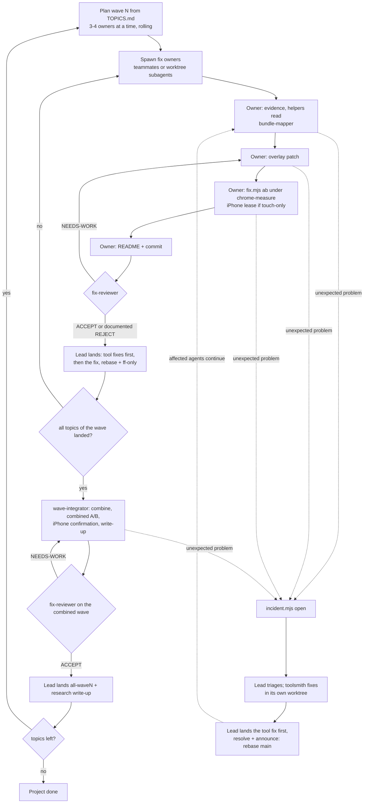

# Lead playbook

For the main Claude Code session in the main checkout: it runs the whole loop (plan a wave, spawn
fix owners, keep them unblocked, review, land, integrate, write up, next wave). Roles, spawn
mechanics and the model/effort guide are in [`AGENT_ROLES.md`](AGENT_ROLES.md); unexpected problems
in [`INCIDENTS.md`](INCIDENTS.md); rules in `CLAUDE.md` "Hard rules". Merges into `main` use
**rebase + `git merge --ff-only` only**: no merge commits, no `--no-ff`, no squash; if ff-only fails,
rebase again.

## Standing authority

The user made the lead the orchestrator until the job is done (2026-10-01): triage incidents, spawn
toolsmiths, fix owners, integrators and reviewers, start new topic owners for new findings, land work
(rebase + ff-only) and announce fixes **without asking the user for each step**. The project goal is
"ultra smooth" scrolling: on the calibrated setting, frames >50 ms → 0 and >34 ms → ~0; on the real
iPhone a steady 60 fps under a finger scroll with no frame >50 ms.

Still ask the user for what only they can do or approve: iPhone finger tests, edits to the
enforcement layer (`.claude/settings.json`, `.claude/hooks/`, `.githooks/`) when Claude Code's
safety check blocks them, and anything that leaves this machine.

## The loop



## Definitions of done

- **Topic:** `fixes/README.md` "Definition of done" holds; `fix-reviewer` said ACCEPT (or the README
  says `Status: rejected` with the evidence); landed on `main`; its tool fixes landed before it;
  no active incident assigned to its owner; its locks released; its worktree and branch removed.
- **Wave:** every topic of the wave is done (landed or rejected-with-evidence); every incident
  opened during the wave is resolved or parked with a reason (`incident.mjs list`, which shows only
  active ones, is empty); `fixes/all-wave<N>/` has the combined patch, a combined A/B with `--runs 5` or more, and
  a README that `fix-reviewer` accepted; the iPhone confirmation is done (scripted scroll baseline vs
  combined, finger test for touch-only topics) or its absence is stated; the write-up
  `research/<nn>-wave<N>-results/README.md` is landed.
- **Project:** all 12 topics of [`TOPICS.md`](TOPICS.md) are landed or rejected with evidence; the
  last combined overlay (all waves) is measured in Chrome and on the iPhone; a final research
  write-up summarizes what helped, what didn't and why; `incident.mjs list` is empty; no lock
  holders, no leftover worktrees or branches besides `main`; history is linear.

## 1. Before a wave

- The session must have started after `.claude/agents/` existed (restart otherwise, then check that
  the Agent tool lists `fix-owner`, `toolsmith`, `wave-integrator`, `bundle-mapper`, `fix-reviewer`).
  Worktrees contain only committed files, so commit tooling and docs first.
- `node tools/fix.mjs doctor`, `node tools/lock.mjs status` (no stale holders),
  `node tools/incident.mjs list` (nothing active from a previous session, or deal with it first).
- Noise floor once per session: `node tools/fix.mjs ab --aa --runs 5`; put its table (or the path
  of `out/ab/_aa/<stamp>/results-aa.json`) into every spawn prompt so owners don't each spend lock
  time on it.
- **Staffing.** Pick the wave from [`TOPICS.md`](TOPICS.md): one owner per topic or conflict cluster,
  **3-4 owners at a time** (the agent-teams docs suggest 3-5; the lock makes more pointless). A
  5-run A/B holds `chrome-measure` for about 5-6 minutes; a topic needs 2-3 of them (main run,
  desktop or a re-run after review), so 4 owners already queue about an hour of lock time, plus about
  35 s per `npm test` a toolsmith or a landing runs under the lock. Run a longer wave rolling: when
  an owner finishes, the next topic starts (wave 1 has 7 owners: start 3+6, 4, 5 and 1; then 8, 9, 11).
  Budget one toolsmith slot on top (two at most, on different files) and the integrator after the wave.
- Teammates inherit your effort: `/effort high` before spawning teammates.

## 2. Spawn

Fill in the block from [`AGENT_PROMPT.md`](AGENT_PROMPT.md) (topic, scope, related owners with the
names you are giving them, A/A numbers, and `--on <combined>` for wave 2).

| | agent-team teammate | worktree subagent |
|---|---|---|
| call | `Agent(subagent_type: "fix-owner", name: "fix-<topic>", prompt: …)` | same plus `isolation: "worktree"` |
| use for | topics that must talk: clusters B, C, D, E | independent topics: 1, 9, 11; every toolsmith and integrator |
| worktree | none at start (runs in the main checkout); step 0 of the prompt enters `.claude/worktrees/fix-<topic>` | created from `HEAD` by Claude Code, branch `worktree-<name>` |
| model / effort | definition `model` (opus) unless the prompt names one; effort = **yours** | definition: opus / high |
| its helpers | foreground subagents (it waits) | background subagents, layer 2 of 3 |
| messages | teammates and you by name; permission prompts come to you | `SendMessage` by name; a finished one is resumed by a message; its result arrives as a notification |

- **Toolsmith** (per incident): `Agent(subagent_type: "toolsmith", name: "ts-i<nnn>", isolation:
  "worktree", prompt: …)`, see [`INCIDENTS.md`](INCIDENTS.md) 4.
- **Integrator** (per wave, after it landed): `Agent(subagent_type: "wave-integrator", name:
  "wave<N>", isolation: "worktree", prompt: "wave N, topics in order: …, A/A: …, previous combined:
  all-wave<N-1> | none, touch-only topics: …, research number: <nn>")`.
- Per-call `model: "fable"` is available for L-size topics (cluster A, `morph-scrolljack-passive`,
  `hero-exit-scroll-timeline`); it may bill usage credits.
- Spawn reviewers and mappers **without a `name`**: a named call from your session becomes a
  teammate, which drops the definition's `effort`.

## 3. While owners work

- **Incidents** (tool bugs, environment failures, baseline problems, research questions): follow
  [`INCIDENTS.md`](INCIDENTS.md) sections 3-6. In short: `incident.mjs list` / `show` after each
  report → class, priority, workaround (`update`) → dispatch a toolsmith (tool) or handle / escalate
  (env, baseline) or a `bundle-mapper` (research) → land the fix first (section 5 here) → `resolve`
  → send the printed announcement to every affected agent (teammates and named subagents by
  `SendMessage`; a message resumes a subagent that ended `BLOCKED`).
- **Permission prompts** from teammates and background subagents surface here. Deny any write to
  `site/`, `site-pretty/`, `.githooks/`, `.claude/hooks/`, `.claude/settings.json`, `.serena/`, any
  `git push`/`git add -f`, any chrome-devtools MCP call, and any `git merge` by an owner.
- **iPhone finger tests** (only you can talk to the user): an owner holding the `iphone` lease
  messages "need a finger scroll on <URL>…" → tell the user the URL and what to do (top to bottom,
  then push past the end) and ask them to say when ready → message the owner "user ready, start
  `iphone.mjs record` now" → relay the user's remarks afterwards. One test at a time; the lease queue
  decides the order. You never navigate the phone without holding the lease yourself.
- **Cross-topic disputes:** decide with the conflict table in `TOPICS.md`; one owner changes the
  shared code, the other adapts.
- **Check in** every ~20-30 minutes: `lock.mjs status` (is the queue moving?), `incident.mjs list`,
  idle teammates. An owner stuck on the same step twice gets a question, not a replacement.
- Wait for owners; don't do their work in the lead session.

## 4. Review

When an owner reports done: `Agent(subagent_type: "fix-reviewer", prompt: "topic <t>, worktree
<abs path>, branch <b>, A/A: <numbers>")`. NEEDS-WORK → send the blocking items to the owner, review
again after. A well-documented null or rejected result (README `Status: rejected`) is still worth
landing. For a tool fix that changes measurement code: `prompt: "tool fix, incident I-<nnn>,
worktree <abs path>, branch <b>"`.

## 5. Land (rebase + fast-forward only)

`git worktree list` shows each worktree and branch. Keep the main checkout clean (`git status
--short` empty) before switching anything in it.

**Tool fixes first**, on their own, so every agent gets them. A toolsmith branch holds only tool
commits; test the exact commit **in the main checkout** (it has `site/`, worktrees don't: a test
once passed in a worktree and hung in the main checkout, `7abd290`) and under the lock:

```sh
git -C <toolsmith worktree> rebase main
git -C <toolsmith worktree> diff --stat main...HEAD              # only tools/, tests/; review them and their tests
git switch --detach <toolsmith branch>
node tools/lock.mjs run chrome-measure --owner land-i<nnn> -- npm test
git switch main && git merge --ff-only <toolsmith branch>
node tools/incident.mjs resolve I-<nnn> --by lead --commit <sha> [--remeasure]   # prints the announcement
```

Tool commits inside an owner's branch (a self-fix) land the same way, cut out first: with the tool
commits `<first>..<last>` contiguous in the owner's branch (ask the owner to keep them so),
`git branch land-tool <last> && git rebase --onto main <first>~1 land-tool`, then the `npm test`
and `merge --ff-only land-tool` steps above, then `git branch -d land-tool`.

Then announce ([`INCIDENTS.md`](INCIDENTS.md) 5): every affected agent runs `git rebase main`
(already-landed commits drop out). The fix itself:

```sh
git -C <owner worktree> rebase main
git -C <owner worktree> diff --stat main...HEAD   # only fixes/<topic>/{README.md,patch.diff,results.json}
git status --short                                              # main checkout: nothing modified under fixes/<topic>/
git merge --ff-only <fix branch>                                # in the main checkout; if it fails: rebase again
git worktree remove <owner worktree> && git branch -d <fix branch>   # once the owner is finished
```

`patch.diff` holds Fastwork excerpts: `main` stays local (there is no remote; never push). The
overlay is gitignored and disappears with the worktree; `node tools/fix.mjs apply <topic>` rebuilds
it from `patch.diff`.

## 6. Integrate a wave and start the next

When every topic of the wave is done (section "Definitions of done"), spawn the `wave-integrator`
(section 2). It combines the landed patches (`fix.mjs combine all-wave<N> [all-wave<N-1>] <t1> …`),
resolves only mechanical conflicts, measures, runs the iPhone confirmation through you, and writes
`fixes/all-wave<N>/` and `research/<nn>-wave<N>-results/`. Semantic conflicts come back to you:
send the pair to its owners (resume them) and have one adapt. Review the combined wave with
`fix-reviewer`, land it like a fix. Wave-2 owners start with `node tools/fix.mjs apply all-wave<N>`
in their worktree and pass `--on all-wave<N>` to `edit`, `diff`, `serve` and `ab`.

## 7. Wrap up

Shut down idle teammates, `node tools/lock.mjs status` shows no holder of yours,
`node tools/incident.mjs list` is empty (parked ones are named in the write-up), remove landed
worktrees and branches, and leave port 5173 alone.
